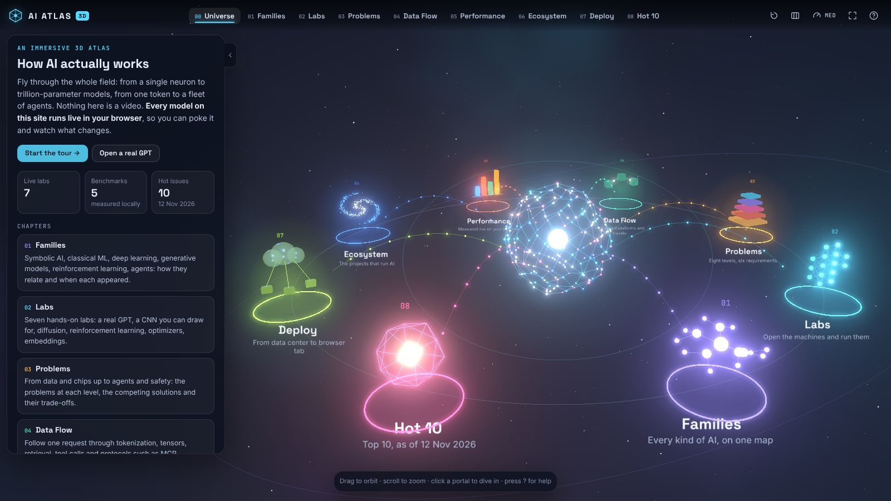

# AI Atlas 3D

An immersive, interactive 3D website that explains how AI works: from a single neuron to
trillion-parameter models, from one token to a fleet of agents.

Nothing on the site is a video. **Every model runs live in the browser**: a real 1M-parameter GPT
predicts tokens, neural networks train while you watch, a CNN reads the digit you draw, particles
are denoised into shapes, agents learn a maze, and the performance comparisons are measured on
your own machine.



## What is inside

| Chapter | Route | What you do there |
| --- | --- | --- |
| **Universe** | `#/` | The hub: fly to any chapter. |
| **Families** | `#/families` | Every kind of AI on one map, as a family tree, a timeline from 1943 or by learning signal. |
| **Labs** | `#/labs` | Seven working models you can take apart (below). |
| **Problems** | `#/problems` | Eight levels of the AI stack, the problems at each level, the competing solutions, and a "requirement lens" that re-ranks them as your priorities change. |
| **Data Flow** | `#/flow` | Follow data through ten pipelines (LLM request, training, RAG, tool calls over MCP, diffusion, vision, speech, serving, agent-to-agent, federated learning): its shape, an example payload and the wire format at every stage. |
| **Performance** | `#/perf` | Quantization, the KV cache, batching, a model bake-off and a hall of sourced records. |
| **Ecosystem** | `#/ecosystem` | A galaxy of the projects that run AI: what each does, its core algorithm, its major process and where it deploys. |
| **Deploy** | `#/deploy` | Ten deployment modes as animated topologies, from a hosted API to a browser tab. |
| **Hot 10** | `#/hot` | The ten hottest issues in AI as of November 2026, each with its own 3D animation and dated sources. |

### The labs

| Lab | Route | The real thing underneath |
| --- | --- | --- |
| Inside a GPT | `#/labs/gpt` | A GPT with 1,071,872 parameters trained on TinyStories: BPE tokens, embeddings, attention maps, the logit lens, sampling, generation. |
| Neural Network Lab | `#/labs/neural` | A multilayer perceptron and backpropagation written from scratch, training on toy datasets. |
| Optimizer Arena | `#/labs/optim` | SGD, Momentum, Nesterov, RMSProp and Adam racing on five loss landscapes. |
| How a CNN Sees | `#/labs/cnn` | A convolutional network trained on MNIST; draw a digit and watch every feature map. |
| Diffusion Lab | `#/labs/diffusion` | DDPM, DDIM and flow-matching samplers with the exact denoiser, plus classifier-free guidance. |
| Plan vs Learn | `#/labs/world` | BFS, Dijkstra, greedy and A* against Q-learning, SARSA and Dyna-Q in one maze. |
| Embedding Space | `#/labs/embed` | Real sentence embeddings, BM25 / dense / hybrid retrieval, and a race between vector indexes. |

## Run it

```bash
npm ci
npm run dev        # http://127.0.0.1:5173
npm run build      # static site in dist/
npm run preview    # serve dist/ on http://127.0.0.1:4173
npm run test:ml    # check the JavaScript models against PyTorch reference values
```

Requirements: Node 22 or newer and a browser with WebGL 2. There is no backend and no run-time
network access: the site is plain static files and works from any path.

## Publish to GitHub Pages

`.github/workflows/pages.yml` builds the site on every push and deploys it from the default branch.

One-time setup: in the repository open **Settings → Pages → Build and deployment** and set
**Source** to **GitHub Actions**. Then push (or run the workflow from the Actions tab). The site
appears at `https://<owner>.github.io/<repository>/`.

The workflow deploys from the default branch and from `main`. GitHub also has to allow the branch
in **Settings → Environments → github-pages → Deployment branches and tags**; a Deploy job that
fails within seconds, before running any step, was rejected by that rule.

## How it is built

One WebGL canvas, one camera and one render loop; chapters are lazy-loaded modules mounted into
the scene one at a time; a glass HUD made of plain DOM floats on top. three.js is the only run-time
dependency. The algorithms live in `src/ml` as plain JavaScript with no rendering code, so they
can be tested in Node.

```
src/core      engine: renderer, camera, picking, HUD, charts, 3D helpers
src/chapters  the top-level chapters          src/labs   the mechanism labs
src/perf      the performance experiments     src/ml     the algorithms themselves
src/data      sourced content                 public/    model weights and data
tools/train   PyTorch scripts that produce the small models
```

See [docs/ARCHITECTURE.md](docs/ARCHITECTURE.md) for the chapter contract, the helper APIs and
the visual rules, and [tools/train/README.md](tools/train/README.md) to retrain the models.

## About the numbers

* **Measured** values (timings, accuracies, perplexities, recall) are computed live by the code in
  `src/ml` on the visitor's device.
* **Quoted** values (prices, benchmark scores, model sizes, the hot-issue facts) live in `src/data`
  with a source URL and a date. The landscape snapshot was taken on 12 November 2026.
* **Ratings** on a 1 to 5 scale are editorial judgments and are labeled as such.

## Credits

Built with [three.js](https://threejs.org) and [Vite](https://vite.dev). Typefaces: Inter, Space
Grotesk and JetBrains Mono (SIL Open Font License). The tiny GPT is trained on
[TinyStories](https://huggingface.co/datasets/roneneldan/TinyStories), the digit classifier on
MNIST, and the embeddings come from
[all-MiniLM-L6-v2](https://huggingface.co/sentence-transformers/all-MiniLM-L6-v2).
